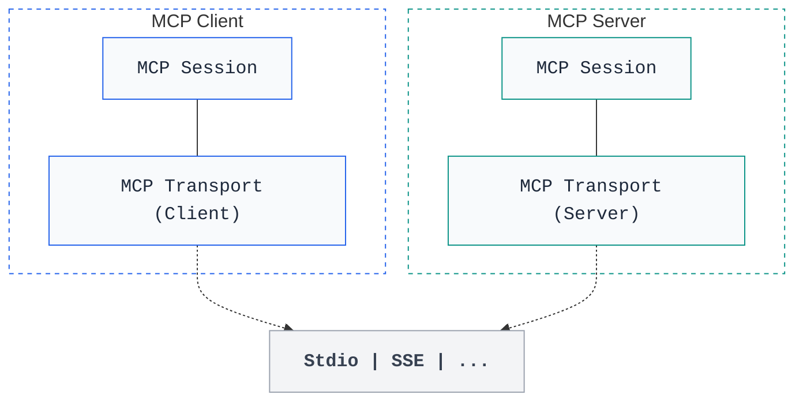

## 模型上下文协议（MCP, Model Context Protocol）
模型上下文协议（MCP, Model Context Protocol） 是一种为 AI 模型设计的通用上下文通信协议。它让模型与外部工具、数据资源和运行环境之间建立一个统一、安全、可扩展的接口。你可以把 MCP 理解为“AI 世界的 USB-C” —— 用一条标准化通道，让模型与一切外部系统互联。它支持多种传输机制以在不同环境中提供灵活性。

MCP JAVA SDK是MCP的JAVA实现，提供了MCP的JAVA SDK，可以让模型方便的使用MCP协议进行同步和异步的服务调用。 

Spring AI 提供 Starters和Java注解来提供对MCP的全面支持,可以很方便的构建MCP Server和client. 

## 架构

