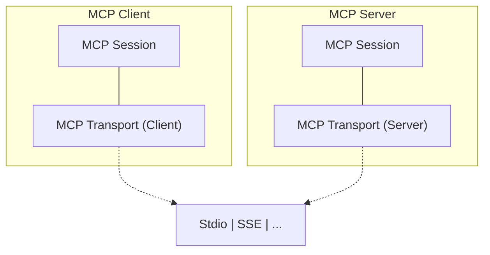
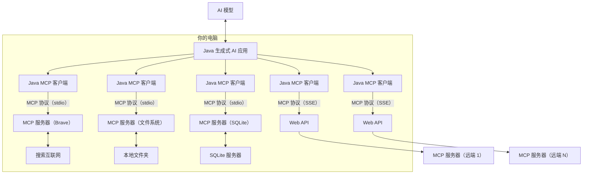
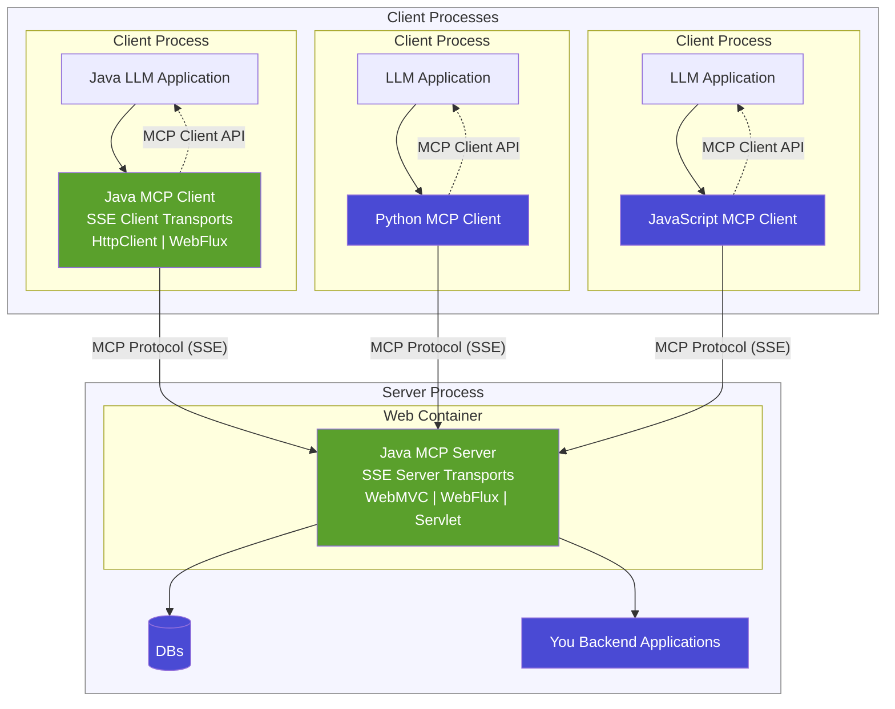
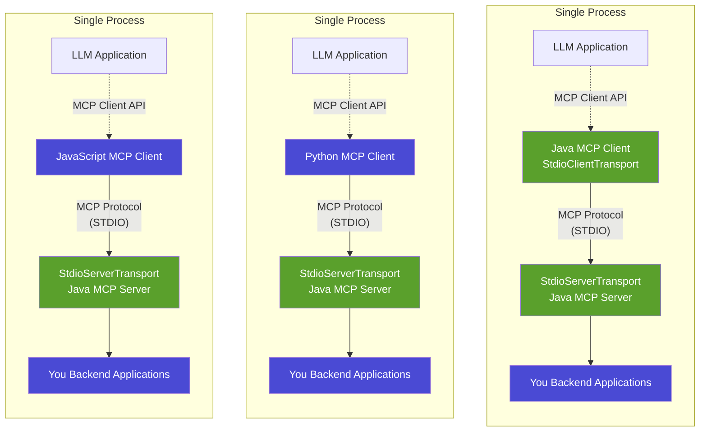

## 模型上下文协议（MCP, Model Context Protocol）
模型上下文协议（MCP, Model Context Protocol） 是一种为 AI 模型设计的通用上下文通信协议。它让模型与外部工具、数据资源和运行环境之间建立一个统一、安全、可扩展的接口。你可以把 MCP 理解为“AI 世界的 USB-C” —— 用一条标准化通道，让模型与一切外部系统互联。它支持多种传输机制以在不同环境中提供灵活性。

MCP JAVA SDK是MCP的JAVA实现，提供了MCP的JAVA SDK，可以让模型方便的使用MCP协议进行同步和异步的服务调用。 

Spring AI 提供 Starters和Java注解来提供对MCP的全面支持,可以很方便的构建MCP Server和client. 

## MCP架构



#### 客户端/服务器层（顶部）

顶层处理主要的应用逻辑和协议操作：
- McpClient - 管理客户端操作和服务器连接
- McpServer - 处理服务器端协议操作和客户端请求
- 这两个组件都利用下面的会话层进行通信管理

#### 会话层（中间层）
中间层管理通信模式并维护连接状态：
- McpSession - 核心会话管理接口
- McpClientSession - 客户端特定会话实现
- McpServerSession - 服务器特定会话实现

#### 传输层（底部）
底层负责实际的消息传输和序列化：
- McpTransport - 管理 JSON-RPC 消息序列化和反序列化
- 支持多种传输实现（STDIO、HTTP/SSE、Streamable-HTTP 等）
- 为所有高层次沟通提供基础服务

### MCP 客户端



 
客户端作为MCP架构的关键部件，负责创建与管理与MCP服务器的网络连接，实现客户端的协议处理：
- 协议版本协商以确保与服务器的兼容性
- 能力协商以确定可用功能
- 消息传输与JSON-RPC通信
- 工具发现与执行
- 资源获取与管理
- 提示词系统交互
- 可选功能：
	- 根系管理
	- 采样支持
- 同步和异步操作
- 传输选择
	- 基于Stdio传输的进程通讯
	- 基于Java HttpClient 的SSE客户端传输
	- WebFlux SSE客户端传输用于反应式HTTP流

### MCP服务器

**MCP Server SSE** 



**MCP Server Stdio**


 
MCP服务器是模型上下文协议（MCP）架构中的基础组件，为客户端提供工具、资源和能力。它实现了协议的服务器端，负责：
- 服务器端协议操作实现
	- 工具暴露与发现
	- 基于URI的资源管理
	- 提示模板的提供与处理
	- 与客户端的能力协商
	- 结构化的日志和提醒
- 并发客户端连接管理
- 同步和异步API支持。
- 实现数据传输
	- Stdio, Streamable-HTTP, Stateless Streamable-HTTP, SSE

详细文档 （https://java.sdk.modelcontextprotocol.io/latest/server/）

## JAVA MCP集成

Spring AI 通过Spring Boot starter 来实现MCP的集成


### 客户端Starters

- spring-ai-starter-mcp-client - 核心starter提供 STDIO, 基于Servlet的Streamable-HTTP, 无状态 Streamable-HTTP 和 SSE 支持
- spring-ai-starter-mcp-client-webflux - 基于WebFlux的Streamable-HTTP, 无状态 Streamable-HTTP 和 SSE transport 实现

### 服务端Starters

#### STDIO
| 服务类型 |依赖 | 属性 |
| --- | --- | --- |
| STDIO  | ```spring-ai-starter-mcp-server```  | ```spring.ai.mcp.server.stdio=true``` |

#### WebMVC
| 服务类型 |依赖 | 属性 |
| --- | --- | --- |
| SSE  | ```spring-ai-starter-mcp-server-webmvc```  | ```pring.ai.mcp.server.protocol=SSE``` |
| Streamable-HTTP   | ```spring-ai-starter-mcp-server-webmvc```  | ```pring.ai.mcp.server.protocol=STREAMABLE``` |
| 无状态 Streamable-HTTP   | ```spring-ai-starter-mcp-server-webmvc```  | ```pring.ai.mcp.server.protocol=STATELESS``` |


#### WebFlux(响应式)
| 服务类型|依赖 | 属性 |
| --- | --- | --- |
| SSE | ```spring-ai-starter-mcp-server-webflux```  | ```pring.ai.mcp.server.protocol=SSE``` |
| Streamable-HTTP   | ```spring-ai-starter-mcp-server-webflux```  | ```pring.ai.mcp.server.protocol=STREAMABLE``` |
| 无状态Streamable-HTTP  | ```spring-ai-starter-mcp-server-webflux```  | ```pring.ai.mcp.server.protocol=STATELESS``` |

#### 使用场景

| 传输协议 | 使用场景 | 特点 |
| --- | --- | --- |
| Stdio | 本地CLI/子进程  | 无网络开销，启动快，处理本地电脑操作|
| HTTP+SSE | 微服务/Web应用  | POST请求+SSE推流|

### 注解

除了程序化的MCP客户端和服务器配置外，Spring AI还通过MCP注释模块为MCP服务器和客户端提供基于注释的方法处理来简化了MCP操作的创建和注册，采用干净的声明式编程模型，并带有Java注释。

MCP 注释模块使开发者能够：

- 利用简单的注释创建MCP工具、资源和提示
- 以声明式方式处理客户端通知和请求
- 减少样板代码并提升可维护性
- 自动生成工具参数的JSON模式
- 访问特殊参数和上下文信息

#### 服务端注解：
- ```@McpTool``` 实现MCP工具JSON自动生成
- ```@McpResource``` 通过URI模板提供资源访问
- ```@McpPrompt```生成提示消息
- ```@McpComplete```  提供自动补全功能

#### 客户端注释
- ```@McpLogging``` - 处理日志消息通知
- ```@McpSampling```- 处理抽样请求
- ```@McpElicitation``` - 处理获取额外信息的请求
- ```@McpProgress``` - 在长时间运行操作中处理进度通知
- ```@McpToolListChanged``` - 处理工具列表变更通知
- ```@McpResourceListChanged```- 处理资源列表变更通知
- ```@McpPromptListChanged``` - 处理提示列表更改通知

#### 特殊参数与注释
- ```McpSyncRequestContext```- 同步操作的特殊参数类型，提供统一界面访问MCP请求上下文，包括原始请求、服务器交换（用于有状态操作）、传输上下文（用于无状态操作）以及方便的日志、进度、采样、引出和根访问方法。该参数会自动注入并排除在 JSON 参数外。支持Complete、提示、资源和工具方法。

- ```McpAsyncRequestContext```- 异步操作的特殊参数类型，提供与```McpSyncRequestContext```返回类型的相同统一接口，只是返回类型是响应式的 。该参数会自动注入并排除在JSON 请求参数外。支持Complete、提示、资源和工具方法。

- ```McpTransportContext```- 用于无状态操作的特殊参数类型，提供对传输层上下文的轻量级访问，无需完整的服务器交换功能。该参数会自动注入并排除在 JSON请求参数外。

- ```@McpProgressToken``` - 标记方法参数以接收请求的进度令牌。该参数会自动注入并排除在生成的 JSON 结构。注：使用```McpSyncRequestContext``` 或```McpAsyncRequest```时，进度令牌可以```Contextctx.request().progressToken()```通过该注释访问，而非使用该注释。

- ```McpMeta```- 特殊参数类型，可访问MCP请求、通知和结果的元数据。该参数会自动注入。注：使用```McpAsyncRequestContext```或```McpSyncRequestContext```时，元数据可通过 ```ctx.requestMeta()``` 获取。

- MetaProvider- 实现了为工具、提示符和资源提供```_meta``` 字段数据的接口。通过```@McpTool ```  ```@McpPrompt``` ```@McpResource```的```metaProvider ```属性和来引用。 


## 搭建MCP天气服务
